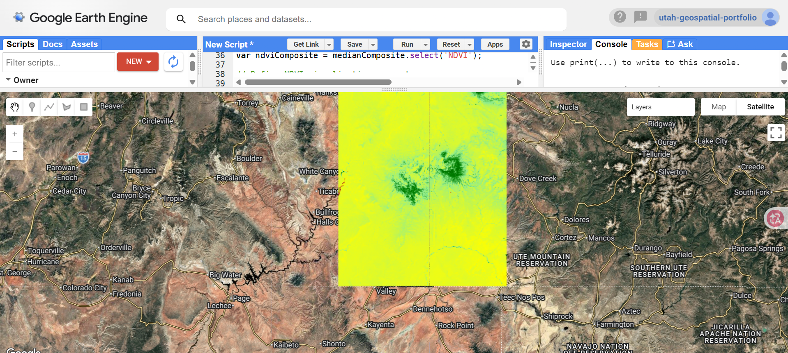

# Utah Critical Minerals NDVI Analysis — Summer 2026

Satellite imagery analysis of Utah mining districts using Google Earth Engine and 289 Sentinel-2 images (June–September 2026).

## What This Shows

- **NDVI (Normalized Difference Vegetation Index)** reveals vegetation health and land cover across the region
- **Yellow areas:** bare soil, desert, disturbed land (mining areas, tailings ponds, reclaimed sites)
- **Green areas:** healthy vegetation (forests, riparian corridors along rivers and streams)
- **Red / dark squiggles:** water bodies, dry washes, or heavily disturbed land with very low vegetation signal

## Data

- **Satellite:** Sentinel-2 (ESA Copernicus program)
- **Dataset:** COPERNICUS/S2_SR_HARMONIZED
- **Images used:** 289 scenes
- **Date range:** June 1 – September 30, 2026
- **Cloud cover filter:** < 20%
- **Processing:** Median composite to remove cloud and shadow artifacts across all 289 images

## Method

1. Define area of interest over Utah mining districts (southern Utah region)
2. Query Sentinel-2 catalog for summer 2026 imagery
3. Filter by location, date range, and cloud cover
4. Calculate NDVI for each image: `(NIR - Red) / (NIR + Red)` using bands B8 and B4
5. Generate median composite to produce a single cloud-free vegetation map
6. Visualize with color ramp: brown → yellow → light green → green → dark green

## Tools Used

- Google Earth Engine (JavaScript API)
- Sentinel-2 Surface Reflectance Harmonized dataset
- NDVI spectral index for vegetation health assessment

## Domain Context

Utah is a critical minerals hub, home to operations including White Mesa Mill (uranium / vanadium), Silicon Ridge (silica), and Great Salt Lake lithium brine extraction. Mining companies, regulators, and ESG auditors use NDVI time-series analysis to:

- Monitor environmental compliance and permitted boundary adherence
- Track vegetation recovery during mine reclamation
- Assess water resource impacts on riparian corridors
- Document land-use change before and after mining activity

## Output

## About

Built by L. Naresh as a portfolio project demonstrating geospatial data analysis and remote sensing capability for AI training and GIS analyst roles.

- GitHub: https://github.com/LaxmanByte
- Location: Salt Lake City, UT
